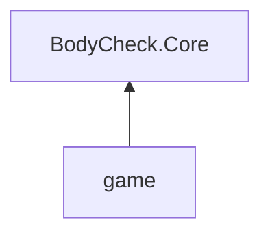

# Architecture

Relevant decision records:
- [000: Initial design](../decision-records/000-initial-design.md)
- [001: Godot's 3D physics engine](../decision-records/001-godot-3d-physics.md)
- [005: Jolt's joint motors for traction](../decision-records/005-jolt-motors-for-traction.md)
- [009: The first level loader](../decision-records/009-level-loader.md)
- [013: The world as a container of rooms](../decision-records/013-world-of-rooms.md)
- [016: Features](../decision-records/016-features.md)
- [017: The playtesting and puzzle design workflow](../decision-records/017-playtesting-workflow.md)
- [019: Carrying blocks on walkers](../decision-records/019-carrying-blocks.md)
- [022: Actions at the end of a tick](../decision-records/022-end-of-tick-actions.md)
- [027: Engine friction for walkers and carrying](../decision-records/027-engine-friction.md)
- [031: Tests in the game's project](../decision-records/031-tests-in-the-game-project.md)
- [032: Player-only situational friction](../decision-records/032-player-only-situational-friction.md)
- [046: Actions as async methods](../decision-records/046-async-actions.md)

This is the top of the architecture docs. Each directory with parts of its own has an `architecture.md`, which describes it and how its parts relate, and links theirs. Follow the links down as far as the level you want to work at.

## Tools

- **Engine:** Godot 4.7.2, .NET build, Forward+ renderer, desktop only. The engine is installed into the repository by `scripts/dev-setup.ps1` and is not on the PATH.
- **Language:** C# on .NET 10.
- **Physics:** Godot's 3D physics engine, Jolt, with gameplay locked to the XY plane. The engine detects collisions, resolves contacts and moves bodies. Our rules push bodies with the engine's forces and impulses. Friction is the engine's, at each body's own coefficient, except the player's, which our rules set each tick. A walker's traction and the player's steadying of what it carries are motors inside the engine, which our rules also set each tick (`005`, `019`, `027`, `032`). Drag is ours. Positions are in single precision, as in Godot's standard builds; both play and drawing hold up to 1e5 tiles from the origin, far beyond any world's size (`013 §6.1`). See [movement.md](movement.md#physics-engine).
- **Levels:** authored in 2D in LDtk, in `game/levels/`, and turned into 3D at load. The LDtk JSON is read at runtime, and is to be moved to an asset pipeline only if the loading code proves too slow, too complex or too fragile (`000 §1.2`).
- **Camera:** Phantom Camera 0.11.0.3, an addon. Out-of-the-box tools are preferred.
- **Modelling:** Blender.

## Layout

- [`src/BodyCheck.Core/`](../../src/BodyCheck.Core/architecture.md): the game's rules, as a C# library.
- [`game/`](../../game/architecture.md): the Godot project: scenes, node scripts, levels, assets, and the tests.
- `docs/`: design docs and decision records.
- `scripts/`: setup and release builds.
- `build/`: release builds (not in Git).
- `Godot/`: the engine, installed by `scripts/dev-setup.ps1` (not in Git).

The game builds on Core's rules, putting them on screen and in the player's hands; Core knows nothing of the game's scenes, assets or input devices.

## Conventions

- **Ticks and steps.** A tick is the game's physics processing; the engine's step follows it. In order:
  1. At the start of a tick, the engine reports the step before, "the last step", through each entity's `_IntegrateForces`: its contacts and what it stands on.
  2. The world runs the actions queued with `IDefer.RunAfterPhysicsStep` during the tick before: "after the engine's step".
  3. The world steps every entity (`Entity.Step`), which runs its controller. Controllers read the world as of the last step.
  4. The world runs the actions queued with `IDefer.RunAfterEntitySteps` this tick, once every entity has been stepped: "after the entity steps".
  5. On a played tick, the world resumes the async actions whose waits are over, from its `ActionTaskQueue` (`046 §1.2`).
  6. The engine steps: "this tick's step". Forces, impulses, motors and friction set during the tick act in it. On a paused tick it doesn't.
  7. Between ticks, Godot may draw frames, which call `_Process`. A frame may come after several ticks, or none, so nothing that the simulation depends on waits for one.

  "Next step" is ambiguous here, so code says "this tick's step" for the one about to run, and "the last step" for the one whose results it reads. Godot runs `CallDeferred` calls made during the physics process before the engine's step, along with other deferred work, so the game queues its own actions on `IDefer` instead, in a known order (`022 §2`).
- **Timing in names.** A method that changes state changes it when it is called; the engine then acts on it in this tick's step. A name says when, if not: `AfterEntitySteps` for a change made after the entity steps, and `AfterPhysicsStep` for one made after the engine's step.
- **`_Process` only changes what is drawn or heard** in anything the simulation runs. It may read state, but never changes physics state or calls what a controller would, so that work done between ticks makes no difference to the simulation.
- **Reading data is typed and validated** (Neil). Data from files is read into types that say what it must be, and anything else is an error, reported with where it is: a missing or null value, a name that isn't one of a fixed set, a number where a name should be. Checks that types can't express are made right after reading. Nothing is silently defaulted or skipped, except parts of a format the game doesn't read. For JSON this is `System.Text.Json`'s source generator over records whose properties are `required`, with nullable annotations respected and enums read by name only (`009 §3`). One stated exception: a configuration names only the features it changes, and the rest are their defaults; a name that isn't a feature is still an error (`017 §2.2`).

## Exports

`scripts/build-release.ps1` exports the game with the "Windows Desktop" preset into `build/windows_release_x86_64/`, and CI runs it on every PR, so an export that fails, or changes a file in the repository, fails CI. The script is the only supported way to export: the preset has no export path, since the editor doesn't create the directories one needs. `scripts/dev-setup.ps1` installs the export templates for Windows into Godot's user data (`031 §2.1`).

The C# build is `ExportRelease`, which, like `ExportDebug`, leaves out the tests, the test packages and the probes (`031 §2.3`). The pack holds every resource, and the levels and configurations, which Godot doesn't import (`009 §4.1`). It leaves out the tests, the test adapter's runner, the probes' sources and LDtk's backups. The build outputs are embedded in the executable, with their debug symbols, so that stack traces from a release build name files and lines (`031 §2.2`). The playtester still plays from the repository (`017 §1.1`).

## Open questions

- Graphics settings' lifecycle and persistence: where they live, how they are saved per machine, and whether they get a record of their own like `Features` (`016 §3.3`).
- How a playtester's maps and configurations reach the repository: Git through a GUI, such as GitHub Desktop, on a branch of their own, with PRs as usual? (`017 §1.2`)
