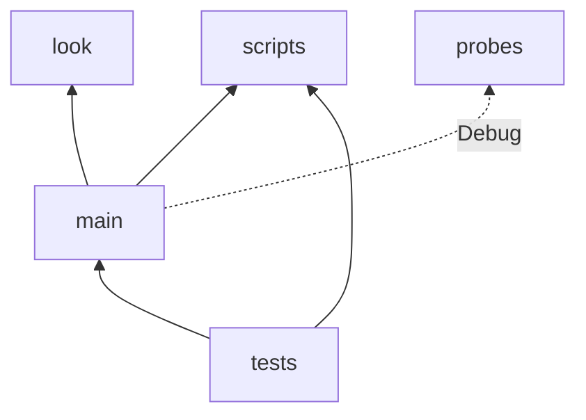

# `game/`

Relevant decision records:
- [006: Models, their base point, and animation](../docs/decision-records/006-models-and-animation.md)
- [017: The playtesting and puzzle design workflow](../docs/decision-records/017-playtesting-workflow.md)
- [031: Tests in the game's project](../docs/decision-records/031-tests-in-the-game-project.md)
- [044: Dialogue](../docs/decision-records/044-dialogue.md)
- [051: The scripted run at the spawn](../docs/decision-records/051-scripted-run-at-the-spawn.md)
- [057: Tile kinds](../docs/decision-records/057-tile-kinds.md)

## What it is

The Godot project: the scenes and the other nodes, which put Core's rules on screen and in the player's hands, and the content they use. It is one C# project, `BodyCheck.csproj`, whose assembly holds the game, and in the editor's build, `Debug`, the tests and the probes too (`031 §2.3`).

## What it is not for

The game's rules: those are Core's, which the game builds on and which knows nothing of the game.

## Directories

- [**`main/`**](main/architecture.md): the main scene and what it puts around a world: the camera, the game's modes, sound, the debug tools, and the playtester's controls.
- **`look/`**: the low-resolution view, the colour pass and the tools for judging the rendering. See [rendering.md](../docs/designs/rendering.md).
- [**`probes/`**](probes/architecture.md): scripted measurements, run headless.
- [**`tests/`**](tests/architecture.md): the tests.
- **`assets/`**: models, sounds, music, fonts, images, and the rooms' environments. Each thing's model files are in a folder of their own, and its sound files in another, each with its sources if it has any, such as a `.blend`. Godot's scenes and resources for it, such as a model's wrapper scene, go one level up, beside those folders. A model is a wrapper scene around an imported glTF file, with its origin at its base. See [models.md](../docs/designs/models.md).
  - `entities/<kind>/`: an entity's `<kind>.tscn` wrapper scene, with its `model/` and `sounds/` folders. An entity doesn't need all three: the robot's scene inherits the player's, and the door's look is built in code with only its sounds. `entities/shared/` holds what more than one kind uses, such as the laser's sound.
  - `tiles/`: each kind's `<kind>.tscn`, with its model in `tiles/<kind>/`.
  - `fonts/`: the dialogue's theme, with each font in its own folder with its licence, including the tofu font; see [dialogue.md](../docs/designs/dialogue.md).
  - `music/<track>/`: a track's `.ogg`, with the LMMS project it was made from.
  - `avatars/` and `prompts/`: the dialogue's avatars and the interact prompt.
  - `authoring/` holds what is for making assets and levels, which the game doesn't load: `ldtk-atlas.png`, LDtk's tileset, which also textures the placeholder tile models, and `128-color-palette.png`, a screenshot of the palette card, scaled down, to draw pixel art from (`057 §3.2`, `§3.3`).
  - `unused/` holds sounds kept for later, under their original names. Godot ignores it.

  Assets made by others are credited in [`ACKNOWLEDGEMENTS.md`](../ACKNOWLEDGEMENTS.md), which keeps what their file names no longer say.
- **`scripts/`**: the scripts that `Script` entities run, in the namespace `BodyCheck.Scripts`, and `ScriptLibrary`, the game's script library, which finds a script by its class's name without the namespace, so that levels name scripts briefly. See [Core's `Scripts`](../src/BodyCheck.Core/Scripts/architecture.md#scripts) for what a script is (`051 §2.2`, `§2.3`).
- **`dialogue/`**: Dialogue Manager's dialogue files, which a dialogue names without the directory or the extension. For now, only `debug`, which the debug key 2 presents. Dialogue Manager's editor plugin lists each in `project.godot` as a translation template, which is committed with the file.
- **`levels/`**: the LDtk project whose worlds are the game's maps. Core's [`Levels`](../src/BodyCheck.Core/Levels/architecture.md) says what it must hold.
- **`configurations/`**: the playtester's configurations, which [`main/`](main/architecture.md#playtesting) describes.
- **`addons/`**: Phantom Camera, without its examples, and Dialogue Manager, whole. `.editorconfig` treats `addons/` as generated code, so formatting and the analyzers leave it as its authors wrote it, and turns off the compiler warnings it has.

An arrow points from a directory to one whose code it uses. Every directory's code may use Core; those arrows aren't drawn.

- **`main/` uses `look/`** for the view it draws the world in.
- **`main/` uses `scripts/`** for the script library it gives each world it builds.
- **`main/` runs probes**, in the editor's build only, when the command line names one.
- **Tests use `main/`** to test the game's modes, and its asset library to build worlds that look as they do in play.
- **Tests use `scripts/`** for the script library, to build the game's worlds as they are played.
