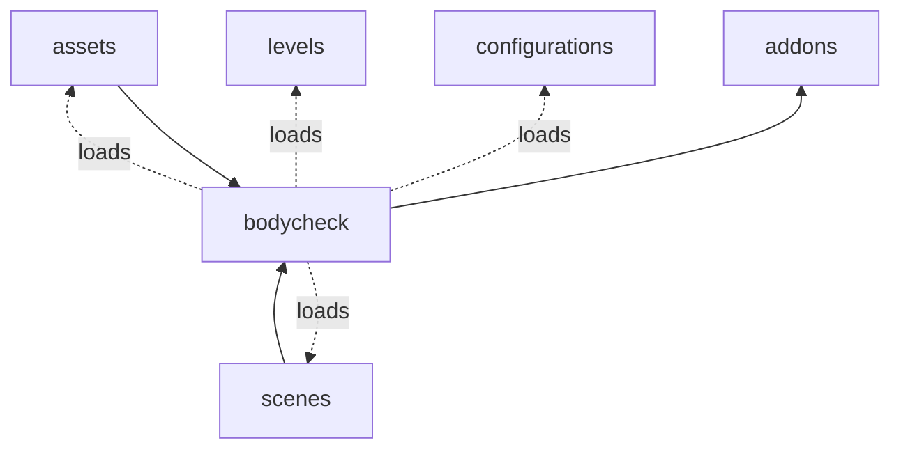

# `game/`

Relevant decision records:
- [006: Models, their base point, and animation](../docs/decision-records/006-models-and-animation.md)
- [017: The playtesting and puzzle design workflow](../docs/decision-records/017-playtesting-workflow.md)
- [021: Sound](../docs/decision-records/021-sound.md)
- [031: Tests in the game's project](../docs/decision-records/031-tests-in-the-game-project.md)
- [044: Dialogue](../docs/decision-records/044-dialogue.md)
- [057: Tile kinds](../docs/decision-records/057-tile-kinds.md)

## What it is

The Godot project: the game's code, which puts Core's rules on screen and in the player's hands, and the content it uses. It is one C# project, `BodyCheck.csproj`, whose assembly holds the game, and in the editor's build, `Debug`, the tests and the probes too (`031 §2.3`).

## What it is not for

The game's rules: those are Core's, which the game builds on and which knows nothing of the game.

## Its parts and how they relate

- [**`bodycheck/`**](bodycheck/architecture.md): the game's code, all of it, and nothing else.
- **`scenes/`**: the top-level scenes, which Godot switches between, each named for its script in `bodycheck/scenes/` in snake case: for now `play.tscn`, the main scene.
- **`assets/`**: models, sounds, music, fonts, images, dialogue and the rooms' environments. Each thing's model files are in a folder of their own, and its sound files in another, each with its sources if it has any, such as a `.blend`. Godot's scenes and resources for it, such as a model's wrapper scene, go one level up, beside those folders. A model is a wrapper scene around an imported glTF file, with its origin at its base. See [models.md](../docs/designs/models.md).
  - `entities/<kind>/`: an entity's `<kind>.tscn` wrapper scene, with its `model/` and `sounds/` folders. An entity doesn't need all three: the robot's scene inherits the player's, and the door's look is built in code with only its sounds. `entities/shared/` holds what more than one kind uses, such as the laser's sound.
  - `tiles/`: each kind's `<kind>.tscn`, with its model in `tiles/<kind>/`.
  - `environments/`: each room environment's scene, with what its backdrop is made of. See [rendering.md](../docs/designs/rendering.md#environments).
  - `dialogue/`: Dialogue Manager's dialogue files, which a dialogue names without the directory or the extension. For now, `debug`, which the debug key 2 presents, and the levels' dialogues. Dialogue Manager's editor plugin lists each in `project.godot` as a translation template, which is committed with the file.
  - `fonts/`: the dialogue's theme, with each font in its own folder with its licence, including the tofu font; see [dialogue.md](../docs/designs/dialogue.md).
  - `music/<track>/`: a track's `.ogg`, with the LMMS project it was made from.
  - `avatars/` and `prompts/`: the dialogue's avatars and the interact prompt.
  - `authoring/` holds what is for making assets and levels, which the game doesn't load: `ldtk-atlas.png`, LDtk's tileset, which also textures the placeholder tile models, and `128-color-palette.png`, a screenshot of the palette card, scaled down, to draw pixel art from (`057 §3.2`, `§3.3`).
  - `unused/` holds sounds kept for later, under their original names. Godot ignores it.

  Assets made by others are credited in [`ACKNOWLEDGEMENTS.md`](../ACKNOWLEDGEMENTS.md), which keeps what their file names no longer say.
- **`levels/`**: the LDtk project whose worlds are the game's maps. Core's [`Levels`](../src/BodyCheck.Core/Levels/architecture.md) says what it must hold.
- **`configurations/`**: the playtester's configurations, which [`bodycheck/scenes/`](bodycheck/scenes/architecture.md#playtesting) describes.
- **`addons/`**: Phantom Camera, without its examples, and Dialogue Manager, whole. `.editorconfig` treats `addons/` as generated code, so formatting and the analyzers leave it as its authors wrote it, and turns off the compiler warnings it has.

A solid arrow points from a directory to one whose code it uses, and a dotted one to content that code loads by its `res://` path. Every directory's code may use Core; those arrows aren't drawn.

- **Scenes attach code's scripts**: a top-level scene its script in `bodycheck/scenes/`, and an entity's or an environment's scene the scripts of its nodes.
- **Code loads content**: the asset library loads the entities', tiles' and environments' scenes, the dialogue box the dialogue files, the avatars and the theme, and the top-level scene the levels and the configurations.
- **Code uses the addons**: the camera Phantom Camera, and the dialogue box Dialogue Manager.

## What belongs to this level itself

- **The project's settings**, in `project.godot`, which names the main scene and the physics layers, and holds the addons' settings. Keep the order in which the Godot editor writes it.
- **The bus layout**, `default_bus_layout.tres`, which has `Sfx` and `Music` buses, which send to `Master`, and a low-pass filter on `Master`, left off, which the game's modes use to muffle sound (`021 §2.2`).
- **The export preset**, in `export_presets.cfg`, which leaves out the tests, the probes, the test adapter's runner and LDtk's backups. See [the exports](../docs/designs/architecture.md#exports).
