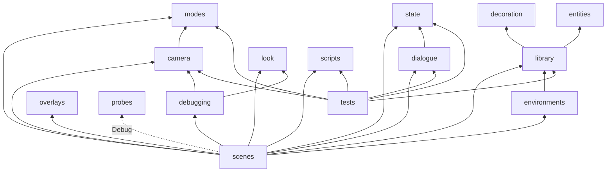

# `game/bodycheck/`

Relevant decision records:
- [012: Subsystems in `BodyCheck.Core`](../../docs/decision-records/012-core-subsystems.md)
- [031: Tests in the game's project](../../docs/decision-records/031-tests-in-the-game-project.md)

## What it is

The game's code: the scripts of its scenes and nodes, which put Core's rules on screen and in the player's hands, and the tests and probes. It is split into parts, one per subdirectory, each in the namespace `BodyCheck.` and its directory's name in Pascal case, as Core's subsystems are (`012`).

## What it is not for

Content: scenes, resources, models, sounds, levels, dialogue files and configurations, even those that exist only to hold a script. Code reaches content by its `res://` path, and content attaches code's scripts by theirs.

## Its parts and how they relate

- [**`scenes/`**](scenes/architecture.md): the top-level scenes' scripts, which put the other parts together: for now `Play`, and the playtester's controls.
- [**`state/`**](state/architecture.md): the game's state, which the game owns and Core sees a view of.
- [**`modes/`**](modes/architecture.md): the game's mode, its pauses and slowdowns, and how each sounds.
- [**`camera/`**](camera/architecture.md): the camera, its framing of the player, and the map of where its view may be.
- [**`dialogue/`**](dialogue/architecture.md): the dialogue presenter and its text box.
- [**`overlays/`**](overlays/architecture.md): what is drawn over the world by mode: the letterbox, the menu, the interact prompt and the phase's aim.
- [**`library/`**](library/architecture.md): the asset library, which gives Core what to draw for entities, tiles and environments.
- [**`entities/`**](entities/architecture.md): the scripts in entities' scenes, which make them look and sound as their state and cues say.
- [**`environments/`**](environments/architecture.md): the mixer that blends a world's environments, and the backdrops' layers.
- [**`decoration/`**](decoration/architecture.md): the decorators, which add things to each room of an environment.
- [**`look/`**](look/architecture.md): the low-resolution view, the colour pass and the tools for judging the rendering.
- [**`debugging/`**](debugging/architecture.md): the debug and playtesting overlays.
- [**`scripts/`**](scripts/architecture.md): the scripts that `Script` entities run, and the script library.
- [**`probes/`**](probes/architecture.md): scripted measurements, run headless.
- [**`tests/`**](tests/architecture.md): the tests.

An arrow points from a part to one whose code it uses. Every part may use Core, and the root; those arrows aren't drawn. There are no cycles.

- **Scenes use everything else**, to put a world together with its camera, its environments, its mode, its overlays, the dialogue box and the debug tools, and give it the asset library, the script library and the game's state. Nothing uses them.
- **Scenes run probes**, in the editor's build only, when the command line names one.
- **The camera uses modes** to look only while playing, to hold the lead outside play and cutscenes, and to tell the mode when the map's tween back is done.
- **Dialogue uses the state**, which a dialogue file branches on and which holds the states of the entities it is about.
- **The debug tools use the camera** to draw its map, and **the look** for the game's viewport, which the collisions are drawn for.
- **Environments use the library** for each environment's scene.
- **The library uses decoration** to decorate each room, and **entities** for the door's sounds, which it builds in code.
- **Tests use** the parts they test, the library to build worlds that look as they do in play, the script library to build the game's worlds as they are played, and the state that those worlds read.

## What belongs to this level itself

- **The rules for parts are Core's rules for subsystems**, in the root `AGENTS.md`: no cycles, light references, and a new `using` of another part is a new dependency, to check against the graph above. The root, the namespace `BodyCheck` itself, is for things that more than one part needs, and holds nothing yet.
- **Scenes live outside.** A scene and its script are in different directories: a top-level scene is in `game/scenes/`, named for its script in snake case, and every other scene is in `game/assets/`, beside what it is made of.
- **The editor's build only.** Tests and probes are only in the editor's build, `Debug`, where Godot defines `TOOLS`; exports leave them out (`031 §2.3`), and so does code under `#if TOOLS`.
- **Namespaces match directories.** The project's `RootNamespace` is empty, so that the analyzer's rule that a namespace matches its directory expects `bodycheck.look` for `game/bodycheck/look/`, which, ignoring case, `BodyCheck.Look` does.
