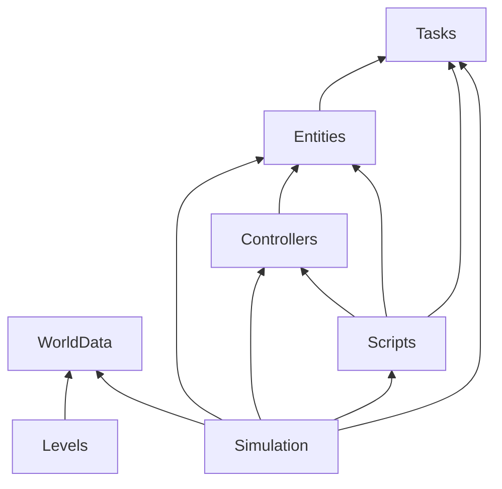

# `BodyCheck.Core`

Relevant decision records:
- [002: `BodyCheck.Core` depends on GodotSharp](../../docs/decision-records/002-core-depends-on-godotsharp.md)
- [005: Jolt's joint motors for traction](../../docs/decision-records/005-jolt-motors-for-traction.md)
- [008: Telemetry, and a debug overlay drawn at the window's resolution](../../docs/decision-records/008-telemetry-and-overlay.md)
- [009: The first level loader](../../docs/decision-records/009-level-loader.md)
- [012: Subsystems in `BodyCheck.Core`](../../docs/decision-records/012-core-subsystems.md)
- [015: The phase ability](../../docs/decision-records/015-phase.md)
- [016: Features](../../docs/decision-records/016-features.md)
- [017: The playtesting and puzzle design workflow](../../docs/decision-records/017-playtesting-workflow.md)
- [018: Game time and real time](../../docs/decision-records/018-game-and-real-time.md)
- [021: Sound](../../docs/decision-records/021-sound.md)
- [022: Actions at the end of a tick](../../docs/decision-records/022-end-of-tick-actions.md)
- [025: Platforms that move along any line](../../docs/decision-records/025-platforms-on-any-line.md)
- [029: Tunable bodies](../../docs/decision-records/029-tunable-bodies.md)
- [030: Gameplay speed](../../docs/decision-records/030-gameplay-speed.md)
- [036: Telemetry keeps the values reported to it](../../docs/decision-records/036-telemetry-keeps-original-values.md)
- [043: Triggers, actions and scripts](../../docs/decision-records/043-triggers-and-scripts.md)
- [045: Control entities in the world](../../docs/decision-records/045-control-entities-in-the-world.md)
- [046: Actions as async methods](../../docs/decision-records/046-async-actions.md)
- [047: `Once`, and routing actions](../../docs/decision-records/047-once-and-routing.md)
- [048: Triggers set off by touch](../../docs/decision-records/048-touch.md)
- [049: Doors and their stops](../../docs/decision-records/049-doors-and-stops.md)
- [050: The cutscene mode](../../docs/decision-records/050-cutscene-mode.md)
- [051: The scripted run at the spawn](../../docs/decision-records/051-scripted-run-at-the-spawn.md)

## What it is

The game's rules, as a class library: entities, character controllers, tuning, the world, its rooms and their tiles. It defines node classes, so its rules need a running engine (`005 §3`, which supersedes that part of `002`). It references the GodotSharp assembly of the installed engine, so `scripts/dev-setup.ps1` has to be run before it builds (`002`), and Godot's source generators, without which the engine never calls a node class's overrides.

Core's classes have no `res://` path, so they are created in code and can't be attached to a scene in the editor.

## What it is not for

Anything that knows the Godot project's scenes or asset paths, or reads input devices: those are the game's.

## Subsystems

Core is split into subsystems, each a subdirectory and a namespace (`012`). The rules for adding to them are in the root `AGENTS.md`.

- [**`Entities`**](Entities/architecture.md): the things in a room that have a body, and what a controller of one is. Not what any of them does.
- [**`Controllers`**](Controllers/architecture.md): what decides each entity's actions each tick. Not new capabilities of a body.
- [**`WorldData`**](WorldData/architecture.md): the world and its rooms, as data. Nothing that runs.
- [**`Levels`**](Levels/architecture.md): reading LDtk levels into the world's data. Not what a room means once read.
- [**`Simulation`**](Simulation/architecture.md): the world brought to life, with its entities stepped each tick. Not presentation.
- [**`Tasks`**](Tasks/architecture.md): tasks that resume only on a tick, and their scheduler. Not what runs on them, or when in a tick.
- [**`Scripts`**](Scripts/architecture.md): what runs the control entities, which route actions to their targets, and what a script is and sees. Not what a body does when an action reaches it, or the scripts themselves.

An arrow points from a subsystem to one it uses. Every subsystem may use the root, which uses none of them, so the root is at the bottom of every chain; those arrows aren't drawn. There are no cycles.

- **Controllers use entities** through what a body offers: forces, impulses, motors and queries, and through `IWorldView`, what they can see of the world beyond their entity. Entities know nothing of controllers beyond the interfaces they define for them, so a controller doesn't know where its entity is in a room or how it got there.
- **Entities use tasks** for running an action: the interface that a route's target implements returns a `TickTask`, and is given the `ITick` to run on (`047 §2.2`).
- **Scripts use entities and tasks** to run actions on their targets, through that interface alone, so a runner can't reach past it to a controller or a body (`043 §3.2`).
- **Scripts use controllers** for the player's: a script drives the player with input on its controller, in a cutscene, through `IScriptWorld`, what a script sees of the world, which extends what controllers see (`051 §2.4`, `§3.3`).
- **Levels produce the world's data.** The world's data knows nothing of where it came from.
- **Simulation joins the rest.** It builds each entity from the world's data, gives it its controller, and steps it; none of the subsystems it uses know about it. It gives controllers the world itself, as an `IWorldView`, and scripts as an `IScriptWorld`.
- **Simulation runs the world's tasks** on a scheduler of its own, at its point in the tick.
- **Simulation builds the routes.** It builds a runner for each control entity from its configuration, and resolves each step to its target's runner or its body's controller, so that Scripts knows nothing of the world's data (`047 §2.3`).

## How a tick runs

The order of a tick is in [the conventions](../../docs/designs/architecture.md#conventions). Within it:

- `WorldNode` steps each entity, which switches its motors off, applies its carrier's steadying, and runs its controller's `Apply`, with an `IDefer` (`022 §2.1`).
- **Controllers can defer actions to later in the tick.** A controller hands an action to its `IDefer` for one of two points. `RunAfterEntitySteps` is for an action that changes the world at once, such as moving a body, so that no controller sees it in the same tick: `WorldNode` runs these once it has stepped every entity, on either path, before the engine's step. `RunAfterPhysicsStep` is for an action whose effect controllers this tick must not see even in the engine's step, such as a change of gravity they reckoned with: `WorldNode` runs these at the start of the next tick, played or paused, before it steps any entity. `IDefer` has only those two, so a controller can't run the actions itself. If a tick's entity steps fail partway, `WorldNode` drops that tick's actions, so they never run against a later tick's world (`022 §2.1`).
- **A controller can ask for the game to pause**, to decide something with everything else standing still: the player's does while a phase is aimed. While the game is paused for that, controllers run on a second path beside the normal one: the game calls `WorldNode.StepPaused`, which calls each `Entity.StepPaused`, which calls the controller's `ApplyPaused`. A controller asks through `RequestsPause`, which its entity passes on, and `WorldNode.PauseRequested` says whether any does. Both are default interface members that do nothing, so only controllers that pause have them. Nothing moves on this path but what controllers defer until after the entity steps: the engine doesn't step (`015 §5.10`). The game decides whether a tick is played or paused.
- **Controllers get game time and real time.** `Apply` takes each tick's length on both clocks: game time, which the engine's time scale shortens, and real time, a physics tick's length whatever the scale. `ApplyPaused` takes real time only, since no game time passes. A timer that governs the world runs on game time, and one about the player's fingers on real time (`018 §1.1`, `§1.2`). A feature that is a duration on game time is given in game seconds, and one on real time in ticks at `Features.TuningTicksPerSecond`, converted by `Features.TicksToTime`, so that its unit tells its clock (`030 §2.6`).
- **The world's tick runs tasks.** Running an action is awaitable, so that whatever ran it can wait until it finishes: a `TickTask`, which `WorldNode` resumes once in each played tick, after the entity steps and their deferred actions, before the engine's step, with waits on game time (`046 §1.2`). It is ours rather than .NET's `Task` or Godot's `ToSignal`, whose continuations run outside the world's tick: there the engine's queries fail, some changes to bodies are refused, forces would be applied as often as frames come, what runs while the tree is paused would move actions on behind the menu, and an exception wouldn't fail the tick (`043 §2.4`). A failed task fails the tick, as a failed entity step does.
- **What runs in the world can ask for a cutscene**, as a controller asks for a pause: a script, or a dialogue's runner, holds one through `IScriptWorld.HoldCutscene`, with a `CutsceneRequest` for how it is to be presented, and `WorldNode.CutsceneRequest` is the join of every hold's, or null if nothing holds one. The game plays a cutscene while it isn't null, starting after the tick, so controllers see it from the next, and presents it as it asks (`051 §3.1`, `§3.2`, `§3.6`).
- **Touches set off triggers just before the tasks run**, so that what a touch starts runs on in the same tick (`048 §1.4`).
- **Actions that take several ticks are async methods.** A controller's response to an action may be an `async` method that returns a `TickTask`, given the world's `ITick` to wait on, such as a door's `Close`, which thrusts the door down until it stops, and freezes it. It runs where the world resumes tasks, after the entity steps and their deferred actions, so it changes bodies at once, with no `IDefer`. What a controller does every tick stays in `Apply` (`046 §1.1`, `§1.2`).
- **Cues.** A controller says that something happened to its entity by raising a cue on it, which the entity passes on as an event. Logic knows no sounds or effects: whatever draws the entity reacts to cues. A cue names what happened, not the reaction, so that particles, one-shot animations and the like can react to the same cues later (`021 §1.3`).

## The root

The root holds only what several subsystems, or the game, share: telemetry, `Constants`, `Features`, `PhysicsLayer`, `GameMode`, what the game is doing, which the game holds and controllers can see, `PlayerInput`, what the player is pressing, `TriggerAction`, the actions a route can ask of an entity (`045 §4.3`), extension members on Godot's vector types, and a JSON converter that reads enums by name only. It is not for anything that belongs to one subsystem, even if it is small, except a feature: a value that shapes gameplay belongs in the features, even if only one subsystem reads it. Nor is it for anything derived from a feature or cached from one, or for settings that belong to a machine rather than to gameplay, such as graphics.

### Telemetry

Game code pushes measurements to `Telemetry`, by `Metric`, an enum. Each metric keeps its last value, as it was reported, until it is reported again or the telemetry is reset. Whatever wants the measurements reads them: the debug overlay, and tests. A read throws if the value is of another type, or if nothing has been reported, unless it gives a fallback for that (`036 §2`). Nothing that reports knows what reads, so telemetry puts no constraint on how game code is divided up (`008 §1`).

### Constants

`Constants` holds constants that more than one subsystem or the game needs: `TilePixels`, the size of a tile's face in pixels (`009 §5.1`), a level's size in tiles, and `Gravity`, read from the project setting, for what needs gravity without an entity's gravity scale (`025 §2.2`). Other constants move there as we come across them (`012 §2.3`).

### Features

`Features` is a record of the values that shape gameplay: the tuning of the player's running, jumping, phasing, carrying and spawning, which includes the choices of `PhaseThrow` and `SpawnMotion`, of the robots' and platforms' controllers, of the walkers' friction, and each kind of body's mass and engine friction (`029 §1.1`). Every name is prefixed with what it tunes: `Player`, `Robot`, `Platform`, `PlayerBlock`, `Block` or `Door` (`016 §3.6`).

- `Features.Current` is the only source of each: what uses a feature reads it there, when it uses it. `Features.Set` replaces it and raises `Features.Changed`, and `Features.Reset` puts back the defaults, which are the properties' initializers; tests that change features reset them. `Features.Read` reads a configuration (`017 §2`).
- A feature is a simple value that nothing derives from or caches, except an action in progress, such as a jump or a phase being aimed, which goes on with the values it started with, so a change takes effect at the next one: changes are eventually consistent, with that bound (`016 §3.1`).
- A feature the engine holds, such as a body's mass or the tiles' friction, is put there by what owns what holds it, at the start of the tick after `Features.Changed`, so a change takes effect at the next tick (`029 §2`).
- **Gameplay speed.** The feature `GameplaySpeed`, from 0.5 to 1, is how fast the game plays: the game sets the engine's time scale to it, times any slowdown. Every other feature is tuned at speed 1. What runs on game time, which is every force, speed and world timer, scales with it; what runs on real time doesn't (`030 §1.1`, `§1.3`).
- Graphics settings, the camera's values and debug toggles are not features (`016 §3.2`, `§3.4`).

### Physics layers

`PhysicsLayer` names the engine's physics layers, as flags: static tiles, liquids, triggers, props such as blocks, characters, which include platforms and doors, and door stops, which only doors collide with. The game's project settings name the same layers, and a test checks that the two agree. An entity's layer and mask are part of its tuning. Its mask is by default every layer that has a collider but door stops: tiles and both kinds of entity. A door's leaves out tiles, so that it can hide in them, and takes in door stops (`049 §1.1`). Queries should try to use layers instead of filtering what they find.

## Open questions

- Whether `IDefer`'s two points become points of `ITick` to await, if a second async action needs one. `NextTick` from `Apply` already resumes after this tick's entity steps, after all of their deferred actions, though only on played ticks. `RunAfterPhysicsStep` has no counterpart: the world never runs its tasks before the entity steps (`046 §1.7`).
- Guidance on the implicit concurrency of async actions and scripts: what can change while one waits, and how to guard against it. To be written once the routing, the door and scripts have used them (`046 §1.9`).

- Can the Godot editor attach a script to a scene only when the script is in the Godot project itself? Believed so. Core's node classes are created in code, which doesn't need it (`005 §3.2`).
